# Documentação dos Testes - API de Estacionamento

Aluno: Luiz Felipe Pintor - RA 347395-2025

## 1. Identificação do sistema

**Nome do projeto:** API de Estacionamento

**Objetivo:** controlar as vagas de um estacionamento e cobrar pelo tempo que o veículo ficou.
O sistema precisa garantir que uma vaga não seja usada por dois carros ao mesmo tempo, que o mesmo carro
não entre duas vezes e que o valor cobrado siga as regras de tolerância, hora adicional e limite diário.

**Principais funcionalidades:**

- registrar a entrada de um veículo
- registrar a saída e calcular o valor
- consultar um ticket
- consultar as vagas livres por tipo

**Tecnologias:** Java 21, Spring Boot 3.5, PostgreSQL, H2 (nos testes), JUnit 5, Mockito, AssertJ, MockMvc, JaCoCo e Maven.

## 2. Estratégia de testes

Escolhi focar em três tipos de teste: repetidos, de concorrência e de carga.

O motivo é que um estacionamento de verdade não é usado por uma pessoa de cada vez. Tem várias cancelas
funcionando juntas, horário de pico e muitas entradas e saídas no dia. Os erros mais sérios, como dois carros na
mesma vaga, o mesmo carro com duas entradas abertas ou uma vaga que nunca é liberada, dificilmente aparecem
num teste que roda uma vez só.

- **Testes repetidos** (`RepetidoTest` e o CT04): rodam a mesma operação milhares de vezes com dados aleatórios.
  Servem para pegar erros que acontecem só de vez em quando. Como o dado é sorteado, em vez de conferir um valor
  exato eu confiro regras que sempre têm que valer, por exemplo: o valor nunca é negativo e nunca fica mais barato
  se o carro ficar mais tempo. Foi esse tipo de teste que encontrou a falha descrita na seção 5.
- **Testes de concorrência** (`ConcorrenciaEntradaTest`): disparam várias threads ao mesmo tempo, como se vários
  carros chegassem juntos. Servem para ver se duas requisições conseguem pegar a mesma vaga.
- **Testes de carga** (`CargaTest`): sobem a aplicação de verdade e mandam milhares de requisições HTTP
  com vários clientes ao mesmo tempo, medindo o tempo de resposta e se dá algum erro.

Antes desses, fiz testes mais simples para garantir que cada regra funciona sozinha. Não adianta testar
com milhares de requisições se o cálculo da tarifa estiver errado.

- **Unitários** (`CalculadoraTarifaTest`, `EstacionamentoServiceTest`): testam as regras isoladas, usando Mockito
  para simular o banco. No cálculo da tarifa usei valores limite (15, 16, 60, 61 minutos...), porque é nas bordas
  das faixas que costuma ter erro.
- **Integração com banco** (`RepositoryIntegrationTest`): testam as consultas no banco.
- **API e funcional** (`EstacionamentoControllerTest`, `FluxoCompletoIntegrationTest`): testam os endpoints,
  os códigos HTTP e as mensagens de erro, e um fluxo completo de entrada e saída.

Os testes rodam com o banco H2 em memória, assim qualquer pessoa consegue rodar `mvn test` sem precisar
configurar o PostgreSQL.

## 3. Casos de teste

| ID | Funcionalidade | Cenário | Entrada | Resultado esperado | Resultado obtido | Status |
|----|----------------|---------|---------|--------------------|------------------|--------|
| CT01 | Tarifa | Valores nos limites das faixas | 0, 15, 16, 60, 61, 120, 121, 420, 421, 1439, 1440, 1455 e 2880 min | 0, 0, 10, 10, 15, 15, 20, 40, 40, 40, 40, 50 e 80 reais | Valores iguais ao esperado | PASS |
| CT02 | Tarifa | Saída antes da entrada | saída 1 min antes | Erro | Erro | PASS |
| CT03 | Tarifa | Datas nulas | entrada ou saída nula | Erro | Erro | PASS |
| CT04 | Tarifa | Tempo aleatório, 10.000 vezes | 0 a 3 dias | Valor nunca negativo, nunca acima do limite e nunca menor com mais tempo | Regras sempre válidas | PASS |
| CT05 | Entrada | Entrada válida | ABC1234, CARRO | Ticket aberto e vaga ocupada | Ticket aberto e vaga ocupada | PASS |
| CT06 | Entrada | Placas válidas | ABC1234, ABC1D23, abc-1234, " abc1d23 " | Aceitas | Aceitas | PASS |
| CT07 | Entrada | Placas inválidas | AB1234, ABCD123, 1234ABC, ABC12345, ABC-12 | "Placa inválida" | "Placa inválida" | PASS |
| CT08 | Entrada | Placa vazia | "  " | "Placa é obrigatória" | "Placa é obrigatória" | PASS |
| CT09 | Entrada | Carro que já está dentro | placa com ticket aberto | Entrada recusada | Entrada recusada | PASS |
| CT10 | Entrada | Sem vaga | MOTO sem vaga livre | Entrada recusada | Entrada recusada | PASS |
| CT11 | Entrada | Tipo de vaga nulo | tipo nulo | Erro | Erro | PASS |
| CT12 | Saída | Saída depois de 2h | 08:00 às 10:00 | R$ 15,00 e vaga liberada | R$ 15,00 e vaga liberada | PASS |
| CT13 | Saída | Ticket já fechado | ticket fechado | "já foi encerrado" | "já foi encerrado" | PASS |
| CT14 | Saída | Ticket que não existe | id 99 | "não encontrado" | "não encontrado" | PASS |
| CT15 | Banco | Primeira vaga livre | vagas 3 e 1 de carro, 2 de moto | Vaga 1 | Vaga 1 | PASS |
| CT16 | Banco | Vaga ocupada | única vaga PcD ocupada | Nenhuma vaga | Nenhuma vaga | PASS |
| CT17 | Banco | Contar vagas livres | 3 carros (1 ocupado) e 1 moto | 2 carros e 1 moto | 2 carros e 1 moto | PASS |
| CT18 | Banco | Número de vaga repetido | duas vagas número 1 | Erro no banco | Erro no banco | PASS |
| CT19 | Banco | Ticket aberto por placa | 1 aberto e 1 fechado | true e false | true e false | PASS |
| CT20 | API | Entrada válida | JSON válido | HTTP 201 | HTTP 201 | PASS |
| CT21 | API | Entrada sem placa | JSON sem placa | HTTP 400 | HTTP 400 | PASS |
| CT22 | API | Tipo de vaga que não existe | CAMINHAO | HTTP 400 | HTTP 400 | PASS |
| CT23 | API | Estacionamento lotado | JSON válido | HTTP 409 | HTTP 409 | PASS |
| CT24 | API | Saída | id 1 | HTTP 200 e valor 15.00 | HTTP 200 e valor 15.00 | PASS |
| CT25 | API | Ticket que não existe | id 99 | HTTP 404 | HTTP 404 | PASS |
| CT26 | API | Vagas livres | MOTO | HTTP 200 e 3 livres | HTTP 200 e 3 livres | PASS |
| CT27 | Fluxo completo | Entrada, entrada repetida e saída | QWE1R23, PCD | Vagas 2, 1 e 2; repetida dá 409; valor 0 | Igual ao esperado | PASS |
| CT28 | Concorrência | 100 carros para 1 vaga | 100 placas | Só 1 entra | Só 1 entrou | PASS |
| CT29 | Repetido | Mesmo carro entra e sai 1.000 vezes | REP1A23 | Vaga sempre liberada | Passou depois da correção (seção 5) | PASS |
| CT30 | Repetido | 1.000 placas válidas aleatórias | placa sorteada | Sempre aceita | Passou depois da correção (seção 5) | PASS |
| CT31 | Repetido | 1.000 placas inválidas aleatórias | placa sorteada | Sempre recusada | Sempre recusada | PASS |
| CT32 | Repetido | 500 consultas de ticket inexistente | id sorteado | Sempre 404 | Sempre 404 | PASS |
| CT33 | Concorrência | 200 carros para 10 vagas | 200 placas | Nunca 2 carros na mesma vaga | Nenhuma vaga repetida | PASS |
| CT34 | Concorrência | Mesmo carro entrando 50 vezes junto | DUP1A23 | Só 1 entrada | Só 1 entrada | PASS |
| CT35 | Concorrência | Mesma saída 20 vezes junto | mesmo ticket | Só 1 saída | Só 1 saída | PASS |
| CT36 | Carga | 5.000 consultas com 50 clientes | GET /vagas/livres | Sem erros e p95 abaixo de 500 ms | 5.000 ok, p95 de 15 ms | PASS |
| CT37 | Carga | 1.000 entradas e saídas com 20 clientes | POST entrada e saída | Sem erro 500 e nenhuma requisição perdida | Sem erro 500 (ver observação na seção 5) | PASS |

## 4. Execução dos testes

Rodei com `mvn test` no Eclipse, com Java 21, no dia 27/09/2026.

O JUnit conta cada repetição e cada valor de teste parametrizado como uma execução separada.
Por isso os 37 casos viraram 13.551 execuções (só o CT04 já são 10.000).

- Execuções: 13.551
- Aprovadas: 13.551
- Reprovadas: 0
- Taxa de aprovação: 100%

| Classe de teste | Casos | Execuções |
|-----------------|-------|-----------|
| CalculadoraTarifaTest | CT01 a CT04 | 10.015 |
| EstacionamentoServiceTest | CT05 a CT14 | 17 |
| RepositoryIntegrationTest | CT15 a CT19 | 5 |
| EstacionamentoControllerTest | CT20 a CT26 | 7 |
| FluxoCompletoIntegrationTest | CT27 | 1 |
| ConcorrenciaEntradaTest | CT28, CT33 a CT35 | 4 |
| RepetidoTest | CT29 a CT32 | 3.500 |
| CargaTest | CT36 e CT37 | 2 |

### Cobertura de código

Usei o JaCoCo para medir a cobertura:

- Linhas: 86% (150 de 174)
- Desvios (if/else): 88%
- Métodos: 91%
- Classes: 100%

| Pacote | Linhas cobertas |
|--------|-----------------|
| service | 100% |
| dto | 100% |
| model | 98% |
| exception | 89% |
| controller | 86% |
| config | 36% |
| br.com.estacionamento | 33% |

O pacote `service`, onde ficam as regras de negócio, ficou com 100% das linhas cobertas.
Os pacotes com menos cobertura têm motivo: o `config` cria os tickets de exemplo, que ficam desligados nos testes,
e o `br.com.estacionamento` só tem o método `main`, que os testes não chamam.

Olhando o relatório detalhado, encontrei alguns trechos que nenhum teste passou:

- consultar pela API um ticket que existe (o CT25 só testa o que não existe). Testei isso na mão pelo Swagger;
- a API respondendo 400 para placa inválida (a placa inválida só foi testada direto no service, no CT07);
- a API respondendo 409 quando o mesmo carro tenta entrar duas vezes ao mesmo tempo (o CT34 chama o service direto);
- tentar ocupar uma vaga que já está ocupada, que não acontece no uso normal porque o sistema só escolhe vagas livres;
- placa `null` no service, porque a API já barra antes.

Não são erros do sistema, mas são pontos que dá para cobrir com novos testes.

### Testes de carga

| Teste | Requisições | Clientes ao mesmo tempo | Requisições por segundo | Tempo médio | p95 | Erros 500 |
|-------|-------------|-------------------------|-------------------------|-------------|-----|-----------|
| CT36 - consulta de vagas | 5.000 | 50 | 6.584 | 7,0 ms | 15 ms | 0 |
| CT37 - entrada e saída | 1.000 | 20 | 843 | 21,6 ms | 25 ms | 0 |

Esses números são do meu computador e mudam de uma máquina para outra.

### Falha encontrada: CT29 e CT30

Na primeira vez que rodei todos os testes, deu 13.551 execuções e 1.701 erros, todos no `RepetidoTest`.

- **O que foi testado:** o mesmo carro entrando e saindo várias vezes seguidas (CT29) e 1.000 placas aleatórias
  entrando e saindo das vagas de moto (CT30).
- **Resultado esperado:** todas as entradas e saídas funcionando e a vaga sendo liberada em toda saída.
- **Resultado obtido:** algumas saídas deram o erro "Saída não pode ser anterior à entrada" e a vaga não foi liberada.
  Como só tem 3 vagas de moto, depois disso o estacionamento ficou "lotado" e os testes seguintes falharam com
  "Não há vagas livres do tipo MOTO".
- **Causa:** o Java pega o horário com precisão de nanossegundos, mas o banco guarda só até microssegundos e
  arredonda. Como a entrada e a saída aconteciam muito rápido, às vezes com o mesmo horário, o arredondamento
  deixava a entrada salva um pouco depois da saída, e aí a validação recusava. Só apareceu porque o teste
  repete milhares de vezes. O PostgreSQL também guarda em microssegundos, então isso podia acontecer no sistema real.
- **Ajuste:** mudei o `EstacionamentoService` para cortar o horário em microssegundos antes de usar
  (método `agora()`). Assim o horário na memória e no banco ficam iguais. Rodei de novo e todos os testes passaram.

### Observação sobre o CT37

O CT37 passou, porque não deu erro 500 e nenhuma requisição se perdeu. Mas percebi pelos números que, mesmo
com 100 vagas livres e só 20 clientes, 764 das 1.000 entradas foram recusadas com 409.

Isso acontece porque o sistema sempre escolhe a vaga livre de menor número. Quando várias requisições chegam
juntas, todas tentam a mesma vaga. O `@Version` garante que só uma consegue, e as outras são recusadas em vez
de tentar outra vaga. Ou seja, o sistema não deixa dois carros na mesma vaga, mas recusa cliente mesmo tendo vaga.

Uma melhoria seria tentar a próxima vaga livre quando isso acontecer, ou sortear a vaga entre as livres.

## 5. Evidências

Todos os arquivos estão na pasta [evidencias](evidencias/).

Todos os testes passando no Eclipse:

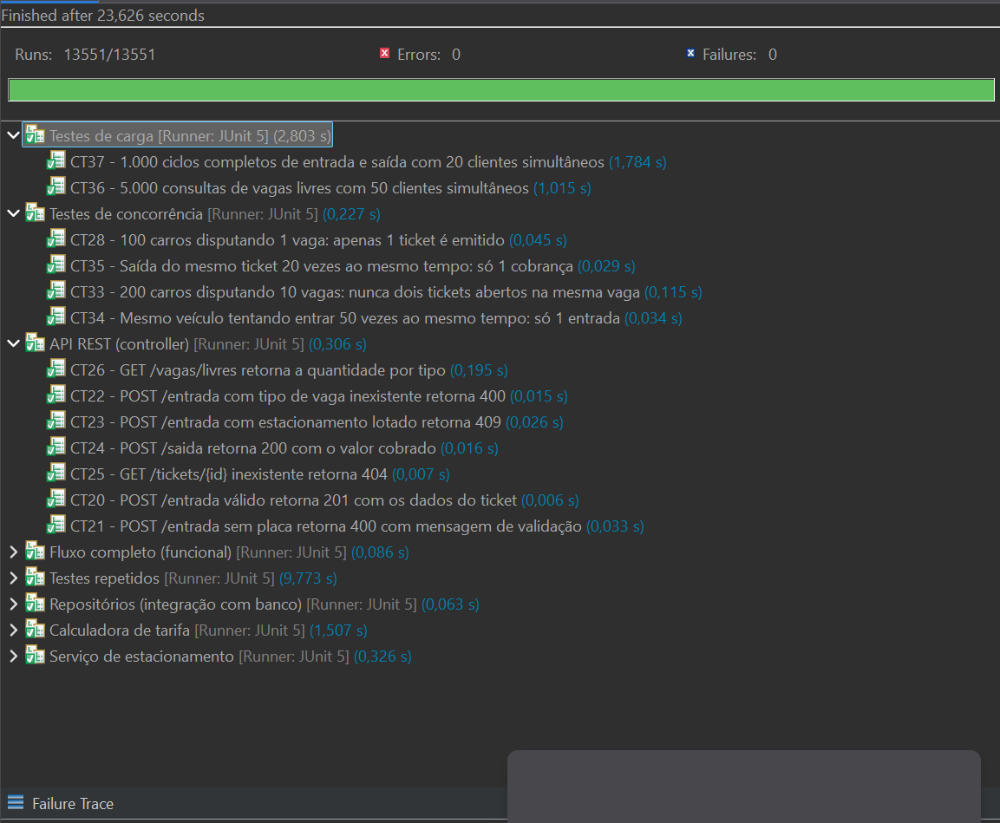

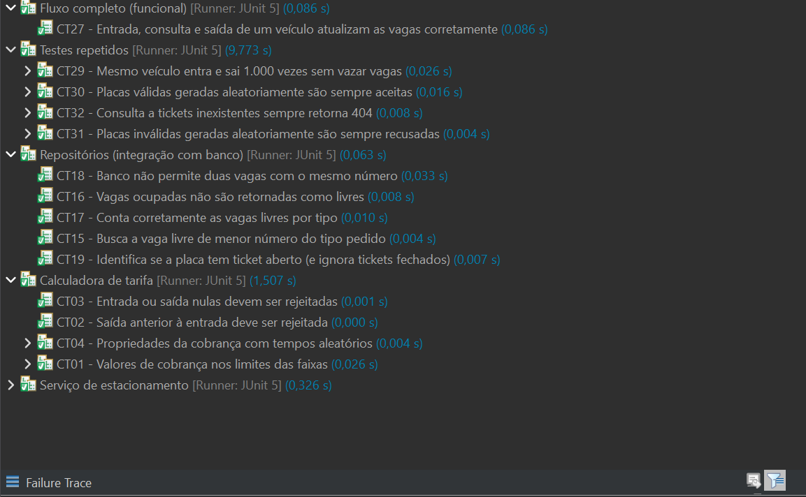

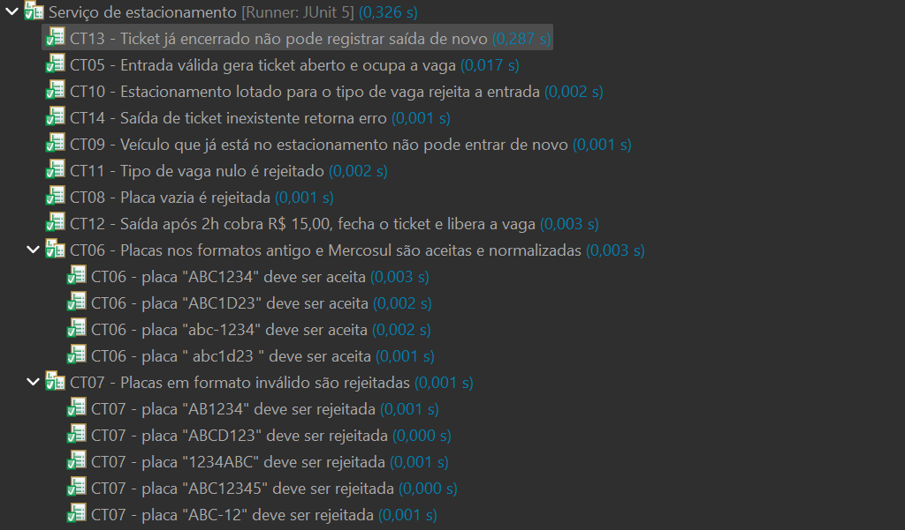

Resultado do `mvn test`:

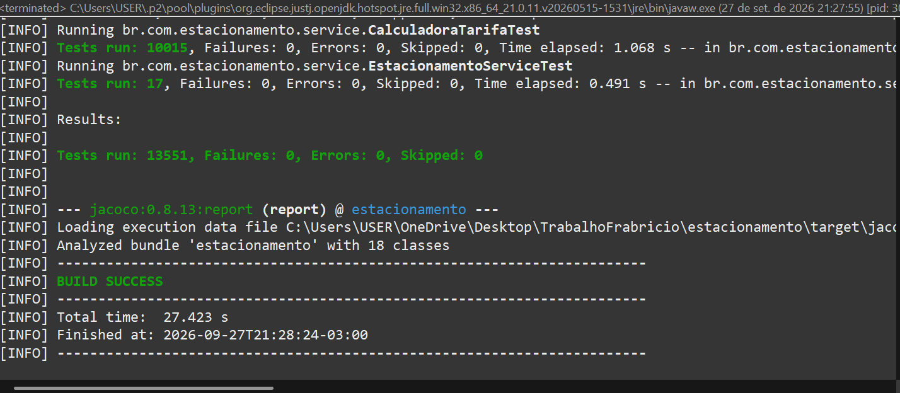

Cobertura do JaCoCo:

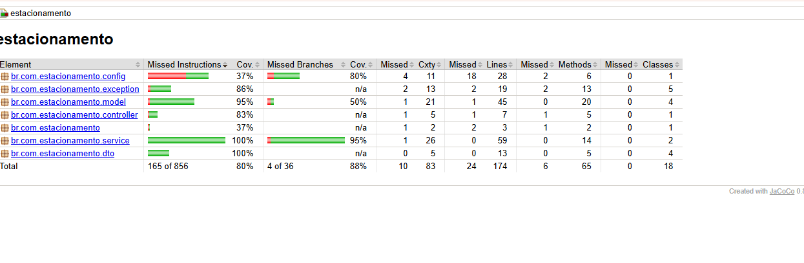

O relatório completo do JaCoCo está na pasta [evidencias/jacoco](evidencias/jacoco/) (baixar e abrir o `index.html`).

Métricas dos testes de carga:

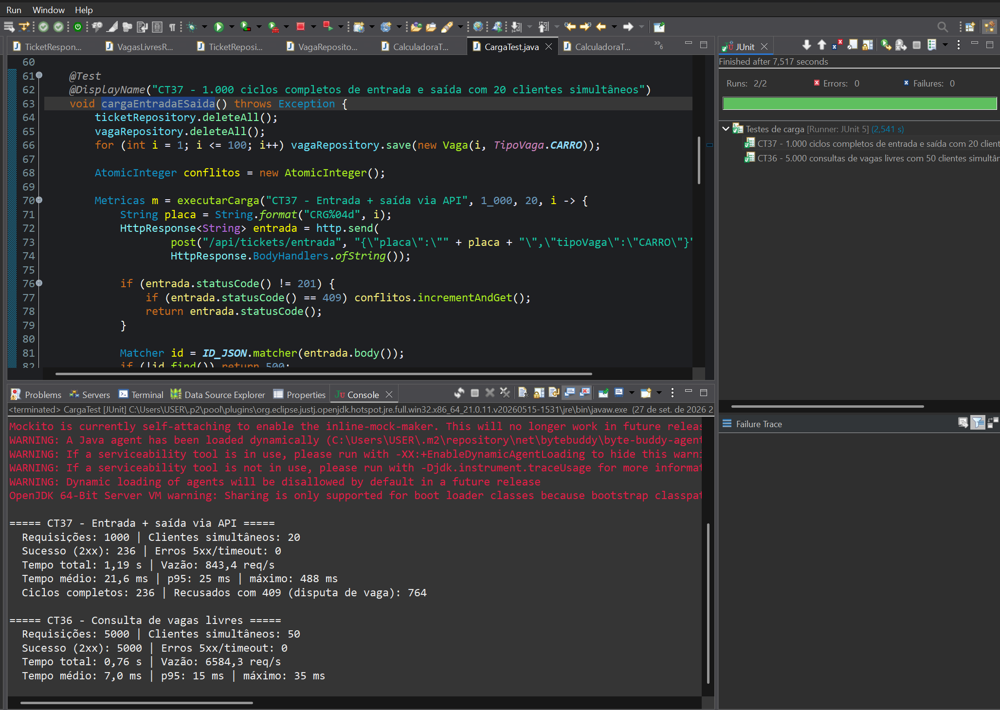

Log da execução que falhou antes da correção: [07-log-falha-1701-erros.txt](evidencias/07-log-falha-1701-erros.txt)

### Testes manuais no Swagger

Também testei a API rodando com o PostgreSQL, pelo Swagger (http://localhost:8080/swagger-ui.html).

Entrada do carro XYZ1A23. Retornou 201 e ele ficou na vaga 3, porque a 1 e a 2 já estavam ocupadas pelos dados de exemplo:

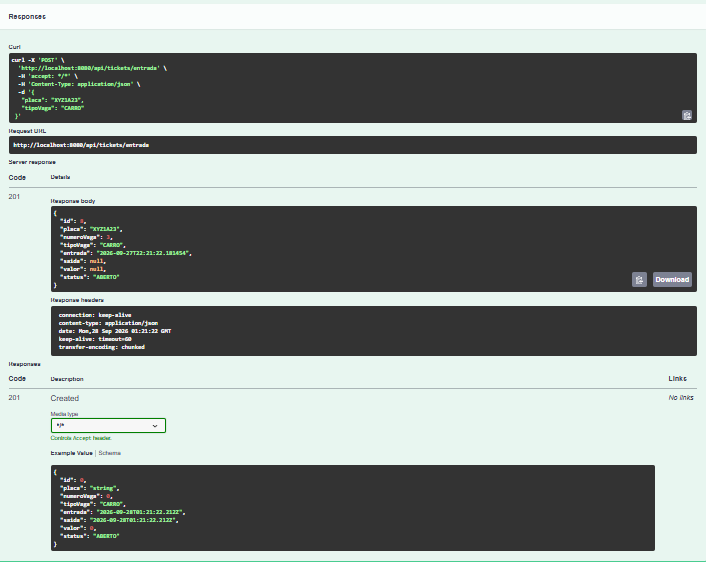

Tentei entrar de novo com a mesma placa e retornou 409:

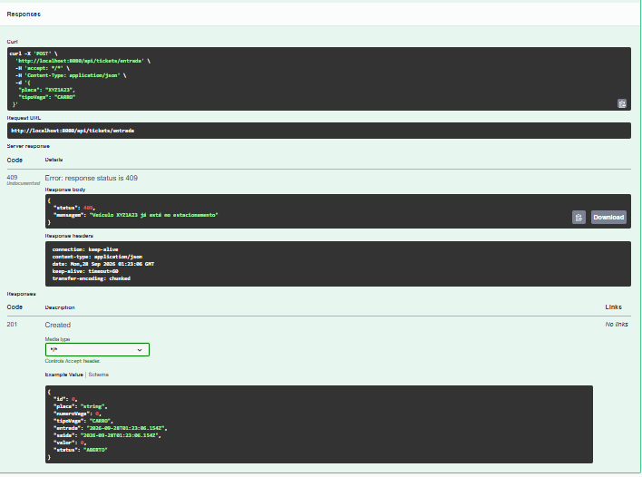

Saída do ticket 8. Ficou uns 2 minutos, então o valor foi R$ 0,00 por causa da tolerância de 15 minutos:

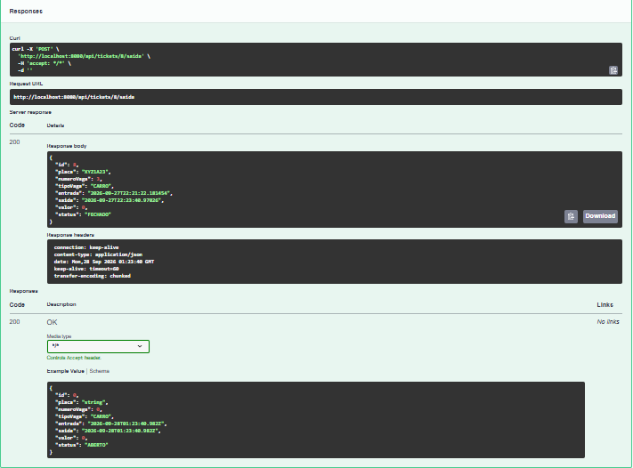

Consulta de vagas livres de carro:

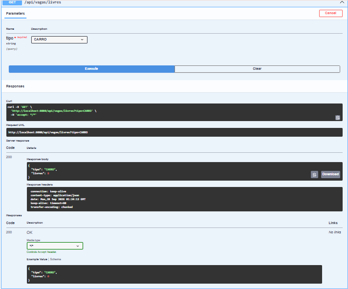

Consulta do ticket 8 depois da saída:

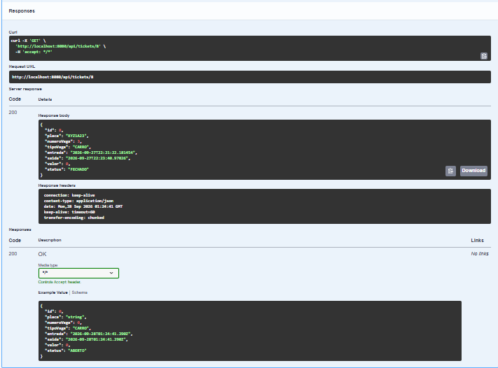
