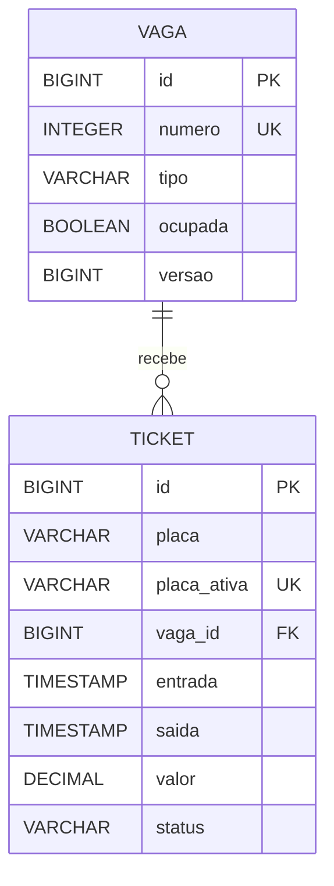

# MER - API de Estacionamento

O banco usado é o PostgreSQL. As tabelas são criadas pelo JPA a partir das classes `Vaga` e `Ticket`.

Uma vaga pode ter vários tickets ao longo do tempo (um carro de cada vez), e cada ticket é de uma vaga só.

## Tabela VAGA

| Coluna | Tipo | Observação |
|--------|------|------------|
| id | BIGINT | chave primária |
| numero | INTEGER | número da vaga, não pode repetir |
| tipo | VARCHAR | CARRO, MOTO ou PCD |
| ocupada | BOOLEAN | se tem carro na vaga |
| versao | BIGINT | usado pelo `@Version` para não deixar duas requisições ocuparem a mesma vaga ao mesmo tempo |

## Tabela TICKET

| Coluna | Tipo | Observação |
|--------|------|------------|
| id | BIGINT | chave primária |
| placa | VARCHAR(7) | placa do veículo |
| placa_ativa | VARCHAR(7) | igual à placa enquanto o ticket está aberto e vazia depois da saída. Como não pode repetir, impede que o mesmo carro tenha dois tickets abertos |
| vaga_id | BIGINT | chave estrangeira para VAGA |
| entrada | TIMESTAMP | data e hora da entrada |
| saida | TIMESTAMP | data e hora da saída |
| valor | DECIMAL | valor cobrado |
| status | VARCHAR | ABERTO ou FECHADO |
